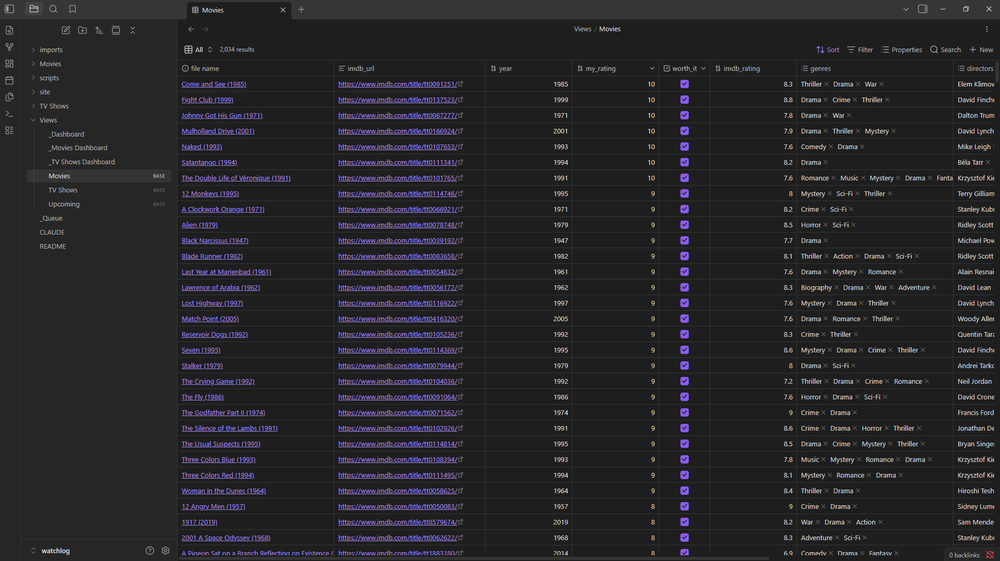
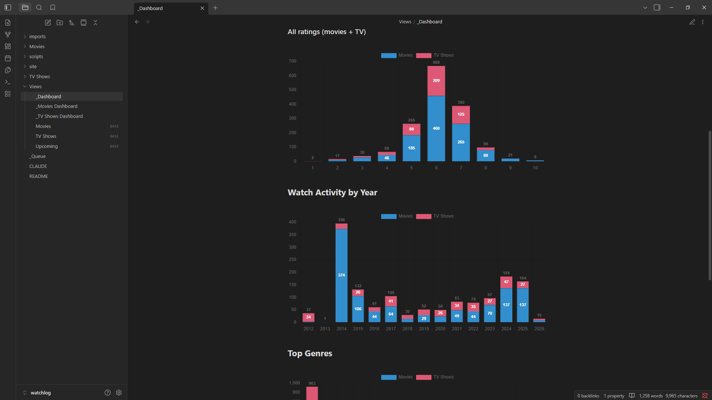

# Watchlog

[](https://watch.gsarigiannidis.gr/)

A personal movie and TV show tracking vault for Obsidian and Claude Code. Import your IMDB ratings and watchlist, enrich each entry with TVmaze and OMDB metadata, then browse everything through live Bases views and DataviewJS dashboards. Add new entries any time via a queue note and a Web Clipper template without touching a CSV.





---

## Requirements

- [Obsidian](https://obsidian.md) — free, available on Windows, macOS, Linux
- [Claude Code](https://claude.ai/code) — Anthropic's AI CLI
- Python 3.12+ with the `requests` library (`pip install requests`)
- A free [OMDB API key](https://www.omdbapi.com/apikey.aspx) — for movie metadata (1,000 requests/day on the free tier)
- An [IMDB account](https://www.imdb.com) — to export your ratings and watchlist as CSV

TVmaze is free and requires no key.

---

## What you get

- **`Movies/` and `TV Shows/`** — one note per title, frontmatter-driven, enriched with IMDB rating, genres, runtime, cast, poster, and OMDB/TVmaze metadata
- **Bases views** — pre-configured views for All, Watched, To Watch, By Rating, and (for TV) Following and Upcoming seasons
- **Dashboards** — DataviewJS charts for ratings distribution, watch activity by year, top genres, top directors, runtime distribution, and series status
- **Queue workflow** — drop an IMDB URL (optionally with a rating) into `_Queue.md` and the cron job creates or updates the note automatically
- **Web Clipper template** — one-click add from any IMDB title page; reads your existing star rating automatically
- **`/import-watchlog` skill** — Claude Code slash command to run a full bulk import with a summary and commit prompt

---

## Setup

### Step 1 — Open this folder in Obsidian

Open the `watchlog/` folder as an Obsidian vault:

- Launch Obsidian
- Click **Open folder as vault**
- Select the `watchlog/` folder

### Step 2 — Install community plugins

In Obsidian, go to **Settings → Community plugins → Browse** and install:

| Plugin | What it enables | Required |
|--------|----------------|----------|
| [Dataview](https://obsidian.md/plugins?id=dataview) | Powers the DataviewJS dashboard charts | Required |
| [Charts](https://obsidian.md/plugins?id=obsidian-charts) | Renders charts via `window.renderChart` | Required |

After installing each plugin, enable it. Dataview settings are pre-configured in this vault.

In Obsidian's file explorer you may want to hide `scripts/` and `imports/`. Go to **Settings → Files & Links → Excluded files** and add them there.

### Step 3 — Add your OMDB API key

```bash
cp .env.example .env
```

Edit `.env`:

```
OMDB_API_KEY=your_key_here
```

Get a free key at [omdbapi.com/apikey.aspx](https://www.omdbapi.com/apikey.aspx).

### Step 4 — Run a bulk import from IMDB (first time)

Export your data from IMDB:

- **Ratings**: Your Ratings → Export (downloads `ratings.csv`)
- **Watchlist**: Your Watchlist → Export (downloads `watchlist.csv`)

Rename the files to `ratings.csv` and `watchlist.csv` and drop them in `imports/`. Then run:

```bash
python3 scripts/import.py --tvmaze --omdb
```

Or use the Claude Code skill — open Claude Code in this vault and say:

```
import my ratings
```

The script is incremental; re-running after a fresh export is safe and fast.

### Step 5 — Set up the queue cron job (optional)

The queue processor runs `_Queue.md` automatically. To set it up:

1. Edit `scripts/watchlog_queue.sh` — the script auto-detects the vault root, or you can set `WATCHLOG_VAULT=/absolute/path/to/watchlog` at the top
2. Make it executable: `chmod +x scripts/watchlog_queue.sh`
3. Add to crontab (`crontab -e`):
   ```
   */15 * * * * /absolute/path/to/watchlog/scripts/watchlog_queue.sh
   ```

### Step 6 — Install the IMDB userscript (recommended)

`userscript/imdb-sync.js` records your IMDB ratings and watchlist changes as you browse, so you never export CSVs again. It runs in Edge or Chrome through [Tampermonkey](https://www.tampermonkey.net/). While you are logged in to IMDB, every title page you open, and every row on your watchlist and ratings pages, is saved as a small JSON file in `_data/imdb/`. It makes no requests, never clicks, and records nothing when you are logged out or the page has not finished loading your data. The queue cron job from step 5 applies the files within 15 minutes:

- A rating sets `my_rating`; a movie becomes `watched`, a TV show follows the status logic below. `date_watched` is the "Rated on" date from your ratings page, or the day it was seen, and is never overwritten.
- A title added to your watchlist that has no note yet is created as `to-watch`.
- An unrated title taken off your watchlist becomes `removed`; re-adding it sets it back to `to-watch`.
- If IMDB shows no rating for a title the vault has rated, nothing changes and a line in `_actions/actions.md` asks you to check it.
- IMDB decides only your rating and watchlist membership. `following`, `last_season_watched` and the other local fields are never touched.

To install:

1. Turn on Tampermonkey's "Allow access to file URLs" (the browser's extensions page, Tampermonkey, Details).
2. Edit the `@require` line in `userscript/stub.user.js` to the absolute path of `userscript/imdb-sync.js` on your machine, then install the stub in Tampermonkey.
3. Create the folder `_data/imdb` in the vault, open any IMDB title page, and pick that folder when the bottom-right button asks. A folder with any other name is refused.
4. After each browser restart, the first IMDB page shows an "Allow" button once. Choose "Allow on every visit" to skip it.
5. In Obsidian: Settings, Files and links, Excluded files, add `_data/`.

### Step 7 — Set up Obsidian Web Clipper (optional)

Import the pre-made template to add entries from IMDB with one click:

1. Install [Obsidian Web Clipper](https://obsidian.md/clipper) for your browser
2. Open the extension → **Templates** → **Import template**
3. Select `scripts/clipper/queue.json`

The template detects your IMDB star rating and appends `URL :: score` (or just `URL` if unrated) to `_Queue.md`. The cron job picks it up within 15 minutes.

---

## Vault structure

```
watchlog/
  Movies/                       one note per film
  TV Shows/                     one note per series
  Views/
    Movies.base                 Bases view: All, Watched, To Watch, By Rating
    TV Shows.base               Bases view: All, Watched, To Watch, Following, By Rating
    Upcoming.base               Bases view: Coming Soon, Ready to Watch
    _Dashboard.md               Combined stats and charts (movies + TV)
    _Movies Dashboard.md        Movies-only stats and charts
    _TV Shows Dashboard.md      TV-only stats and charts
  imports/                      drop IMDB CSV exports here (gitignored)
  _data/imdb/                   observation files from the userscript (gitignored)
  userscript/                   Tampermonkey userscript: imdb-sync.js plus the stub you install
  scripts/
    import.py                   bulk import and sync from IMDB CSV exports
    process_queues.py           queue processor
    watchlog_queue.sh           cron wrapper for the queue processor
    clipper/queue.json          Obsidian Web Clipper template
  .claude/skills/import-watchlog/   Claude Code import skill
  _Queue.md                     add IMDB URLs here to queue entries
  .env.example                  API key template
```

---

## Usage

**Day-to-day:** with the userscript installed, just rate and add titles on IMDB. Without it, navigate to an IMDB title page and click the Web Clipper extension. The entry appears in `_Queue.md` and the cron job processes it within 15 minutes, creating the note and populating all metadata.

**Rating after watching:** click the Web Clipper after rating on IMDB (the template reads your star score), or edit `_Queue.md` directly by appending `URL :: score`.

**Bulk sync:** re-export from IMDB and run `python3 scripts/import.py --tvmaze --omdb`, or ask Claude Code to import.

**Browsing:** open `Views/Movies.base` or `Views/TV Shows.base` for the filterable Bases views. Open `Views/_Dashboard.md` for the charts.

### import.py options

```
--ratings <path>     IMDB ratings CSV (default: imports/ratings.csv)
--watchlist <path>   IMDB watchlist CSV (default: imports/watchlist.csv)
--vault <path>       Vault root (default: repo root)
--tvmaze             Fetch TVmaze data for TV shows
--omdb               Fetch OMDB data for movies (requires OMDB_API_KEY in .env)
--dry-run            Parse and report only: no files written, no API calls
--limit N            Process only the first N entries (for testing)
--ttl-days N         Days before re-checking ongoing shows via TVmaze (default: 30)
--tvmaze-only        Refresh TVmaze fields on TV notes only: no CSVs, never touches ratings or status
--force-stale        Import CSVs older than 24 hours anyway
```

Run `--dry-run --limit 5` first to verify output before a full run.

The import refuses CSV files more than 24 hours old: with the userscript, notes can be newer than an old export, and importing it would roll their ratings and status back. Export fresh CSVs first, or pass `--force-stale` when you mean it.

To keep season dates current without any CSV, add a nightly cron job that re-checks each running show at most once a week:

```
30 23 * * * /usr/bin/python3 /absolute/path/to/watchlog/scripts/import.py --tvmaze-only --ttl-days 7 >> "$HOME/watchlog_tvmaze.log" 2>&1
```

### API caching

**TVmaze:** data is stored in each TV show's frontmatter. Ended shows are never re-queried. Ongoing shows are re-queried only when `tvmaze_last_checked` is older than `--ttl-days`. New fields (language, network, country, poster and so on) trigger a one-time backfill on the next `--tvmaze` run.

**OMDB:** fetched once per movie, gated on `omdb_last_checked`, plus once more for a movie that still has no poster. Re-runs skip already-enriched notes.

---

## Note frontmatter

**Movies** — `title`, `original_title`, `imdb_id`, `imdb_url`, `imdb_rating`, `my_rating`, `year`, `type`, `genres`, `directors`, `runtime`, `status`, `date_watched`, `language`, `country`, `rated`, `metascore`, `awards`, `writer`, `actors`, `poster`, `omdb_last_checked`, `worth_it`

**TV shows** — all of the above (minus movie-only fields) plus `tvmaze_id`, `total_seasons`, `series_status`, `following`, `current_season`, `last_season_watched`, `next_season_start`, `next_season_date`, `tvmaze_last_checked`, `network`, `show_type`, `premiered`, `ended`

**Status values** — `watched`, `watching`, `to-watch`, `to-rewatch`, `removed` (an unrated title taken off the IMDB watchlist)

**Status logic:** no personal rating means `to-watch`. A rated movie is `watched`. A rated TV show is `watching` if the series is ongoing and rated 6+; `watched` if it has ended or is rated below 6.
